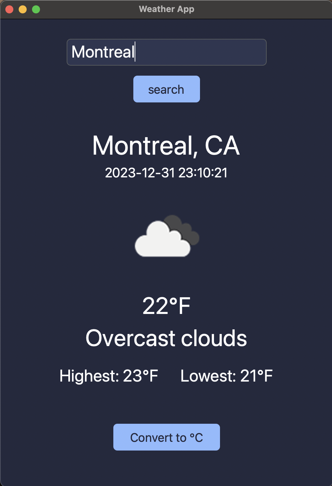

# Weather App

Curious what the weather is like somewhere? Search any location and find out!

## About
To practice my Python skills, I wanted to explore working with APIs, so after much research I came across a weather API and built an app that lets users search for any location.

## How to Use
1. Type the name of a location in the search box.
2. The screen updates to show the current weather conditions.

## Getting Started
1. Make sure you have Python 3 installed.
2. Install the required libraries: `pip install requests`
3. Get a free API key from [OpenWeatherMap](https://openweathermap.org/api)
4. Open `skeleton.py` and replace `YOUR_API_KEY` with your key.
5. Run the app: `python main.py`

## Tools
- Python
- Tkinter
- [OpenWeatherMap API](https://openweathermap.org/api)
- requests

## Future Improvements
- Specify what the user has to type in the search bar (e.g., "Enter a city name")
- Show a multi-day forecast
